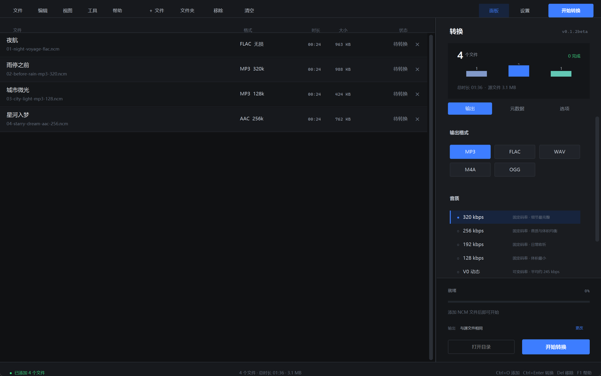
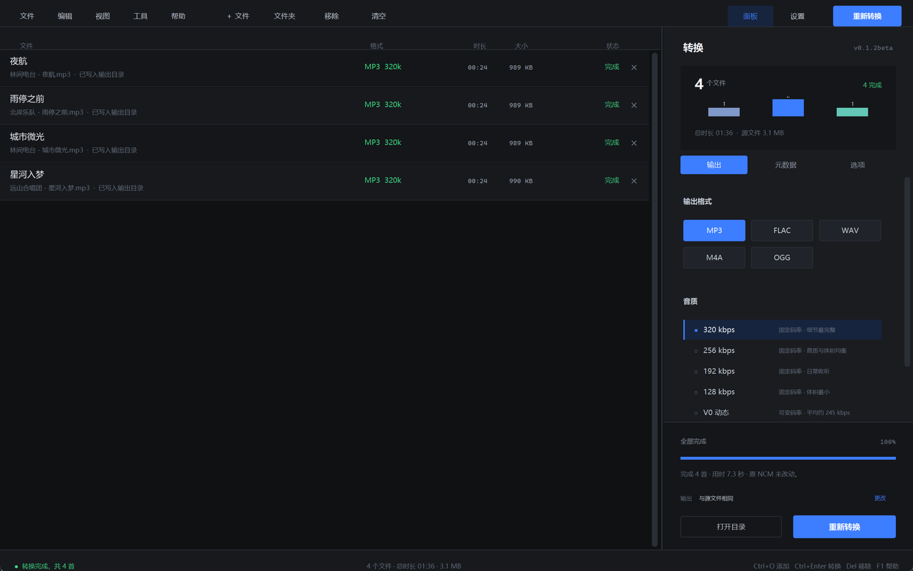

<div align="center">


# ncmelt

**NCM to MP3 converter**

<sub>网易云 NCM 批量解密 · 多格式输出 · 全程本地</sub>


[官网](https://11ly322.github.io/ncmelt/) · [下载](#下载) · [命令行](#命令行) · [从源码运行](#从源码运行) · [构建安装器](#构建安装器)

</div>

---

ncmelt 是一个完全在本机运行的 Windows 转换器。它读取网易云音乐下载的 `.ncm` 文件，解密出原始音频，按你选择的格式和音质重新编码，并写入歌曲名、歌手、专辑和封面。转换过程不需要登录，也不会上传文件。

程序提供桌面界面和同源命令行：可以拖入单个文件或整个文件夹，批量排队、逐首查看状态，也可以直接写成脚本调用。编码完成后会对输出做完整解码校验，确认能播放才写入目标文件。



## 功能

- **NCM 解密**：兼容 NCM 内的 MP3、FLAC、AAC、M4A 源，覆盖标准、较高、极高和无损档位。
- **五种输出格式**：MP3、FLAC、WAV、M4A（AAC）、OGG（Vorbis），每种格式有独立音质档位。
- **批量处理**：拖入文件或文件夹，队列显示格式、时长、大小和状态。
- **完整标签**：可写入歌曲名、歌手、专辑并嵌入封面，文件名支持“歌手 - 歌名”或仅歌名。
- **可播放校验**：编码后使用 FFmpeg 完整解码；失败文件单独标记，临时文件自动清理。
- **安全输出**：原 `.ncm` 只读不改；默认同名自动编号，也可选择覆盖。
- **全程本地**：不需要账号，不访问网易云服务，断网也能转换。
- **同源 CLI**：安装器可选加入 PATH，直接运行 `ncmelt input.ncm -o output.mp3`。

界面由顶部菜单与工具栏、中央文件工作区、可拖宽的右侧转换面板和底部状态栏组成，整个窗口都可以接收拖入文件。



## 下载

从 [Releases](https://github.com/11ly322/ncmelt/releases/latest) 下载最新版本：

| 文件 | 说明 |
| --- | --- |
| `ncmelt-Setup-0.1.2beta.exe` | Windows 安装器：可选安装位置、桌面快捷方式、PATH |
| `ncmelt-0.1.2beta-portable-win64.zip` | 便携版：解压后运行 `ncmelt-gui.exe` |
| `SHA256SUMS.txt` | 发布文件的 SHA-256 校验值 |

系统要求：Windows 10/11 64 位。发布包已内置 FFmpeg 7.1，不需要另行安装。

### 安装器

1. 选择安装目录。默认是 `%LOCALAPPDATA%\Programs\ncmelt`，不需要管理员权限。
2. 可选创建桌面快捷方式。
3. 可选把安装目录加入当前用户的 PATH，之后可在新终端中使用 `ncmelt` 命令。
4. 完成后可直接启动 ncmelt。

卸载会移除程序文件和 PATH 条目，保留个人设置。

## 输出格式与音质

| 格式 | 音质选项 | 说明 |
| --- | --- | --- |
| MP3 | 320 / 256 / 192 / 128 kbps、V0 | 兼容性最好；V0 平均约 245 kbps |
| FLAC | 标准 / 最高 / 快速压缩 | 无损，保留完整音频信息 |
| WAV | 16-bit / 24-bit PCM | 未压缩，适合编辑和归档 |
| M4A | 256 / 192 / 128 kbps AAC-LC | 手机和 Apple 设备友好 |
| OGG | Q8 / Q6 / Q4 Vorbis | 开源播放器友好 |

> 有损源（例如 128 kbps MP3）转成更高码率不会提升原始音质，只会增大体积。界面会在质量选项附近提示。

## 命令行

安装时勾选“添加到 PATH”，或直接在便携版目录运行：

```powershell
ncmelt input.ncm -o output.mp3
ncmelt input.ncm -o output.flac --quality max
ncmelt a.ncm b.ncm -o D:\Music --format flac
ncmelt input.ncm -o output.m4a --quality 256
```

- 输出格式默认从 `-o` 的扩展名推断：`.mp3` / `.flac` / `.wav` / `.m4a` / `.ogg`。
- 不提供 `-o` 时输出到源文件旁边，文件名取歌曲元数据。
- 其他参数：`--overwrite`、`--no-tags`、`--no-cover`、`--name-style title`、`--quiet`。
- 多个输入时，`-o` 必须是输出目录。

查看帮助：

```powershell
ncmelt --help
```

## 从源码运行

要求 Windows 10/11、Python 3.10+（tkinter 随 Python 提供）。

```powershell
python -m pip install -r requirements.txt
python scripts\fetch_ffmpeg.ps1
python app.py
```

仅运行 CLI：

```powershell
python -m ncmelt.cli input.ncm -o output.mp3
```

## 构建安装器

需要 Inno Setup 6（`winget install JRSoftware.InnoSetup`）和构建依赖：

```powershell
python -m pip install -r requirements-dev.txt
python scripts\fetch_ffmpeg.ps1
powershell -ExecutionPolicy Bypass -File build.ps1
```

构建产出：

- `dist\ncmelt\`：GUI + CLI + FFmpeg 的便携目录
- `release\ncmelt-0.1.2beta-portable-win64.zip`
- `release\ncmelt-Setup-0.1.2beta.exe`
- `release\SHA256SUMS.txt`

安装器脚本在 `installer.iss`，安装位置、桌面快捷方式和 PATH 任务都在其中配置。

## 测试

```powershell
python -m unittest discover -s tests -v
```

测试覆盖 NCM 头部/密钥/元数据解析、逐字节音频还原、五种输出格式及全部质量档位、四种输入源、标签与封面、可播放性校验，以及 CLI 的参数校验与输出路径处理。

## 目录

```text
ncmelt/                 应用包
  cli.py                ncmelt 命令行入口
  converter.py          NCM -> 输出格式工作流
  ncm.py                NCM 容器解密
  transcoder.py         FFmpeg 编码、标签与完整性校验
  formats.py            输出格式与音质定义
  gui.py                主窗口与工作区布局
  ui_components.py      队列、摘要、滚动辅助
  ui_side.py            右侧面板、设置与帮助
app.py                  GUI 入口
cli_main.py             CLI 打包入口
docs/                   官网、README 截图与图标
installer.iss           Inno Setup 安装器
build.ps1              一键构建 GUI / CLI / ZIP / 安装器
tests/                  单元与集成测试
```

## 说明与许可

- 源码以 GNU General Public License v3.0 发布，见 [LICENSE](LICENSE)。
- 内置 FFmpeg 为 GPL 构建；第三方组件许可见 [THIRD_PARTY_NOTICES.txt](THIRD_PARTY_NOTICES.txt)。
- 本项目是非官方工具，与网易云音乐及其关联公司无任何关系。
- 仅用于转换你自己合法拥有、供个人使用的音乐文件；请勿传播转换后的受版权保护内容。
- 0.1.2beta 仍属测试版本，界面和参数可能继续调整；欢迎在 [Issues](https://github.com/11ly322/ncmelt/issues) 反馈问题。
